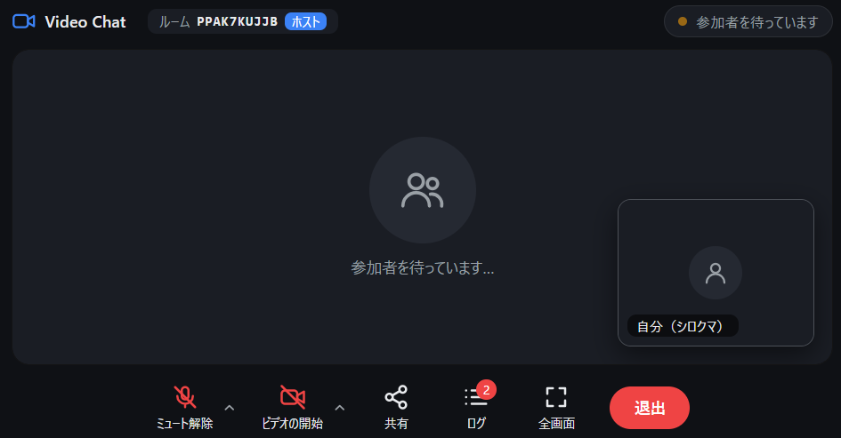

# Video Chat

A video chat application built with **Go WebAssembly** and **WebRTC (P2P)**.
Someone creates a **room** (room ID + password) and sends an invite link; people who receive it join the room, and **up to 4 people** can have a video call.
Each participant gets a random animal name (パンダ / panda, キツネ / fox, …) as a display name, unique within the room.

A single server in this project serves room management, the signaling server, and the web page on **localhost**.
Exposing it to the internet is out of scope for this project; it is meant to be published through a tunnel such as Cloudflare Tunnel (e.g. [gate-house](https://github.com/ka1222te/gate-house)).

> Camera and microphone are turned on in the check screen before entering (they start off). Once on, your video and audio are sent to everyone in the room.



---

## 1. How It Works

```
User A's browser                         User B's browser
   │  https://<public URL>/                 │
   ▼                                        ▼
Tunnel (e.g. gate-house + Cloudflare Quick Tunnel)   ← outside this project
   ▼
Video Chat server (bin/video-chat-server, 127.0.0.1:8080)
   ├ /             Web page (public/index.html, wasm_exec.js, video-chat.wasm)
   ├ /api/rooms    Room creation, pre-join check, leave and delete (JSON) … issues and verifies room IDs and passwords
   ├ /room         Entering the room and the participant list (WebSocket) … checks the password, assigns display names, and notifies everyone of joins and leaves
   └ /signaling    Signaling (WebSocket, Ayame-compatible) … relays SDP / ICE candidates for each pair of participants

   Video and audio flow directly (P2P) between every pair of participants (full mesh; with 4 people, 3 connections each)
   Media uses standard WebRTC tracks; camera/microphone on/off notices use a DataChannel
```

- Everything is served from **one port (a single origin)**, so a tunnel with a single public URL is enough
- In the browser, Go WASM only establishes connections (entering the room and signaling); JS handles media and the UI.
  The endpoints are derived from the page URL (`https://` → `wss://<same host>/...`, `http://` → `ws://`).
  No rebuild is needed when the public URL changes
- A room holds up to 4 people. A newcomer and everyone already in the room each open a one-to-one P2P connection
- Everyone receives the same video, so the per-connection quality drops as the room fills up (2 people: up to 1.5 Mbps / 30 fps / 1280 px, 3: 800 kbps / 24 fps / 960 px, 4: 500 kbps / 20 fps / 640 px)
- Presence is tracked with the `/room` WebSocket, which stays open during the call; leaving the page closes it and counts as leaving the room (signaling closes once a connection is established)
- Rooms are kept only in the server's memory and are deleted when
  - the person who created the room (the host) chooses "ルームを削除して退出" (Delete room and leave); anyone still in the room is removed as well
  - the host has left with "退出" (Leave) and the number of people in the room drops to 0
  - the room has been empty for 24 hours (a safety net, e.g. when the host closes the tab without pressing Leave)
  - the server is stopped or restarted
- Waiting WebSockets receive periodic messages, because Cloudflare closes WebSockets that are idle for about 100 seconds
- STUN / TURN servers for the P2P connection are configured in `.env` and handed to browsers during signaling

### Project Layout

| Path | Contents |
|---|---|
| `client/` | Go WASM that runs in the browser (video chat client) |
| `server/` | Local server (static files, room management, signaling) |
| `go-ayame/` | Ayame client library (Apache License 2.0, see [NOTICE](NOTICE)) |
| `public/` | Files served to browsers. Everything except `index.html` is generated by the build |
| `scripts/` | `setup.sh` (setup / build), `start.sh` (start), `stop.sh` (stop). Can be run from any directory |
| `.env.sample` | Configuration template (copied to `.env` by the first `setup.sh`) |
| `bin/` | Built server (generated) |
| `.state/` | PID file and logs (generated) |
| `assets/` | Images for the README |

---

## 2. Requirements

| Item | Details |
|---|---|
| OS | Linux (macOS / WSL should also work; the scripts use `bash`, `ps`, `stat -c`) |
| Go | 1.26.10 or later; the latest release is recommended (build time only). With an older Go, 1.26.10 is downloaded automatically according to `go.mod` |
| Network | Internet access on the first build to download Go modules |
| Public access | A tunnel such as Cloudflare Tunnel (not included; e.g. gate-house) |
| Browser | A recent Chrome / Edge / Firefox / Safari with WebAssembly, WebRTC and camera/microphone (`getUserMedia`) support |

Browsers only allow camera and microphone access on **HTTPS or `localhost`** pages.
Open the app through the tunnel (HTTPS) or at `http://localhost:8080/` on the server machine.

---

## 3. Setup

### 3.1 Install Go

Install the latest Go from <https://go.dev/dl/> (e.g. into `/usr/local/go`).
Do not use an unsupported Go (1.25 or earlier); it no longer receives security fixes for the standard library.

```bash
go version   # OK if it prints e.g. go version go1.27.x ...
```

If `go` is not on your PATH, set `GO='/path/to/go'` in the `.env` created in 3.2.

### 3.2 Build

Run this in the project directory.

```bash
./scripts/setup.sh
```

It does the following. It is safe to run any number of times (an existing `.env` is left untouched; also use it to rebuild after changing the source).

1. Creates `.env` from `.env.sample` if it does not exist
2. Copies the `wasm_exec.js` matching your Go version into `public/` (copied every time to avoid a version mismatch)
3. Builds the client into `public/video-chat.wasm`
4. Builds the server into `bin/video-chat-server`

### 3.3 Configuration (.env)

The defaults work as-is. Edit `.env` if needed; wrap values in single quotes.
Changes take effect after restarting the server.

| Variable | Default | Description |
|---|---|---|
| `LISTEN_ADDR` | `127.0.0.1:8080` | Listen address. Keep `127.0.0.1`, since public access goes through the tunnel |
| `STUN_URLS` | `stun:stun.l.google.com:19302` | STUN servers (comma-separated) |
| `TURN_URLS` | (empty) | TURN servers (optional). Set these when both users are behind strict NATs / firewalls and STUN alone cannot connect them |
| `TURN_USERNAME` / `TURN_CREDENTIAL` | (empty) | TURN credentials |
| `GO` | (empty) | Path to `go` if it is not on your PATH (build time only) |

`.env` is not tracked by Git. Do not share it if it contains TURN credentials.

---

## 4. Start / Stop / Restart

| Action | Command |
|---|---|
| Start | `./scripts/start.sh` |
| Stop | `./scripts/stop.sh` |
| Restart | `./scripts/stop.sh && ./scripts/start.sh` |
| Rebuild and restart | `./scripts/setup.sh && ./scripts/stop.sh && ./scripts/start.sh` |

### Start

```bash
./scripts/start.sh
```

```
[+] Video Chat サーバ起動 (PID 12345): http://127.0.0.1:8080

ローカル確認 : http://localhost:8080/
外部公開     : gate-house の .env を ORIGIN_URL='http://127.0.0.1:8080' にして gate-house を起動
```

- Runs in the background and keeps running after you close the terminal
- Runs `setup.sh` first if the build outputs are missing
- Checks `/healthz` after starting; if the server exits immediately, the end of the log is shown

### Stop

```bash
./scripts/stop.sh
```

Stops the server with SIGTERM, and kills it if it has not exited within 10 seconds.
Video and audio flow directly P2P, but stopping the server cuts presence tracking (`/room`), so calls end as well.
However, rooms exist only in memory, so **stopping or restarting the server deletes all rooms** (and their invite links stop working).

### Restart

```bash
# apply .env changes
./scripts/stop.sh && ./scripts/start.sh

# apply source changes (rebuild, then restart)
./scripts/setup.sh && ./scripts/stop.sh && ./scripts/start.sh
```

---

## 5. Access

### 5.1 Try It Locally

Open <http://localhost:8080/> in a browser on the server machine.
Create a room in one tab, then open the invite link from "共有" (Share) on the call screen in more tabs (up to 4 in total) and join, to call yourself.

### 5.2 Publish Through a Tunnel (gate-house example)

With [gate-house](https://github.com/ka1222te/gate-house), you can publish the app at the fixed URL `https://<WORKER_NAME>.<subdomain>.workers.dev`, limited to users you allow via Google login.

1. Start this project (`./scripts/start.sh`)
2. Point gate-house's `.env` at this server

   ```bash
   ORIGIN_URL='http://127.0.0.1:8080'   # match LISTEN_ADDR
   ```

3. Start gate-house (restart it if it is already running)

   ```bash
   cd /path/to/gate-house   # wherever gate-house is located
   ./scripts/stop.sh && ./scripts/start.sh
   ```

4. Users open gate-house's public URL, log in with Google, and create or join a room ([5.3](#53-creating-and-joining-rooms)).
   People who receive an invite link are also asked to log in with Google when they open it

Notes:

- gate-house rewrites the WebSocket `Origin` / `Host` to match `ORIGIN_URL` when relaying. This server only accepts same-origin WebSockets, so it works as-is
- For connections through gate-house, the server log (`.state/server.log`) records the logged-in user's email address
- Running a Quick Tunnel directly with `cloudflared tunnel --url http://127.0.0.1:8080` (without gate-house) also works, but then anyone who knows the URL can access it

### 5.3 Creating and Joining Rooms

| Action | Steps |
|---|---|
| Create a room | Press "ルームを作成" (Create room) on the home screen. The password is optional (4–64 characters; generated automatically if left empty) |
| Check before entering | After creating or joining, a check screen opens. Camera and microphone start off; turning them on shows a preview and a level meter, and lets you pick the device. Press "入室する" (Enter) to join the room (pressing "キャンセル" (Cancel) for a room you just created deletes it) |
| Switch devices during a call | Press the "^" next to the microphone / camera button on the call screen and pick one from the list |
| Invite someone | Press "共有" (Share) on the call screen and copy the invite link, room ID, or password to send |
| Join with an invite link | Opening the link shows the join dialog with the room ID and password filled in; press "参加" (Join) |
| Join with ID and password | Press "ルームに参加" (Join room) on the home screen and enter them |
| Leave | Press "退出" (Leave) on the call screen to return home. The host chooses between "退出する" (Leave) and "ルームを削除して退出" (Delete room and leave) |
| Rejoin | When the call drops, press "ルームに入り直す" (Rejoin), or reload the page (in the same tab, the join dialog opens pre-filled, and the host stays the host) |

Invite links look like `https://<public URL>/#room=<room ID>&pw=<password>`. Browsers never send the part after `#` to the server, so the password does not end up in this server's or gate-house's access logs.
It is removed from the address bar once the page opens.

### 5.4 Logs and Status

| Task | How |
|---|---|
| View logs | `tail -f .state/server.log` (room creation, joins, leaves, and wrong passwords) |
| Check status | `curl http://127.0.0.1:8080/healthz`, or `ps -p $(cat .state/server.pid)` |

When `server.log` exceeds 10 MB, it is rotated to `server.log.1` on start.

---

## 6. Troubleshooting

| Symptom | Cause and fix |
|---|---|
| `go が見つかりません` (go not found) | Install Go, or set `GO='/path/to/go'` in `.env` |
| `既に起動中です` (already running) | To restart, run `./scripts/stop.sh && ./scripts/start.sh` |
| `サーバがすぐに終了しました` (server exited immediately) | Check the log shown. For `address already in use`, change the port in `LISTEN_ADDR` (and gate-house's `ORIGIN_URL`) |
| Home buttons are disabled ("読み込み中…" / loading) | The WASM is loading. If it persists, rebuild with `./scripts/setup.sh` and reload |
| "ルームが見つかりません" (room not found) | The room ID is wrong, or the room has been deleted (the host left or deleted it, it was empty for 24 hours, or the server restarted). Create a new room |
| "パスワードを何度も間違えたため…" (too many wrong passwords) | 10 wrong passwords within 10 minutes lock the room temporarily. Wait, or create a new room |
| Stuck at "参加者を待っています" (waiting for someone to join) | Nobody has joined yet. Send the invite link from "共有" (Share) on the call screen |
| A tile shows "接続できませんでした" (could not connect), or no video | The P2P connection with that person failed. Both sides may be behind strict NATs; configure a TURN server in `.env` |
| "このルームは満室です" (room is full) | The room already has 4 people |
| Camera does not start | Make sure the page is on HTTPS or `localhost`, and that camera/microphone access is allowed in the browser |
| WebSocket fails through gate-house | Check that gate-house's `ORIGIN_URL` matches `LISTEN_ADDR`. `origin websocket error` in gate-house's log means this server is not running |

---

## 7. Security Notes

- **Your IP address is visible to everyone in the room.** Video and audio flow directly (P2P) between participants, so each side learns the others' IP addresses while connecting.
  Share the public URL only with people you trust (with gate-house, access can be limited to users allowed via Google login)
- **Room passwords limit who you talk to; they are not access control for the site.** Anyone who can open the page can create rooms.
  Control who can use the site on the tunnel side (e.g. gate-house's allow list), and keep `LISTEN_ADDR` on `127.0.0.1` so that the server cannot be reached except through the tunnel
- **Invite links contain the password.** Anyone with the link can join the room, so send it only to the people you want to invite.
  If you choose your own password, make it hard to guess (leaving it empty generates a random 12-character one)
- The host is identified by a secret value (host token) given only to the host's browser when the room is created. It is not part of the invite link and is stored only in that tab's sessionStorage
- **TURN credentials are handed out to users' browsers.** `TURN_USERNAME` / `TURN_CREDENTIAL` in `.env` are sent to every user during signaling,
  so use credentials dedicated to this app with limited privileges, not a reused password
- Update Go to the latest release regularly to pick up security fixes, and rebuild with `./scripts/setup.sh && ./scripts/stop.sh && ./scripts/start.sh`

The server applies the following protections.

| Protection | Details |
|---|---|
| WebSocket origin check | Only connections from same-origin pages are accepted (others get 403) |
| Room check | Only existing room ID + password pairs are accepted, up to 4 people per room. Passwords are stored as salted hashes and compared in constant time |
| Signaling check | The signaling room for a pair only admits those two people (checked with a token the server issues on entry) |
| Brute-force protection | 10 wrong passwords within 10 minutes temporarily block joining that room |
| Room limit | Up to 1000 rooms at a time. Rooms that have been empty for 24 hours are deleted |
| API protection | `/api/rooms` only accepts same-origin JSON requests (forms on other sites etc. get 403) |
| Connection limit | Up to 256 concurrent WebSockets (503 beyond that) |
| Security headers | CSP (no embedding in other sites, images from `data:` only, connections to the same origin only), `X-Frame-Options`, `X-Content-Type-Options`, `Referrer-Policy`, `Permissions-Policy` |
| Static files | Directory listings are disabled |

In the browser, data received from the other user is handled as follows.

- Video and audio arrive as standard WebRTC tracks played by the browser (encrypted with DTLS-SRTP, so they cannot be altered between sender and receiver)
- The DataChannel only accepts camera/microphone on/off notices. Text messages are truncated to 500 characters and shown as plain text, never interpreted as HTML
- Strings from other users or the server, such as display names, are always shown with textContent (never interpreted as HTML)

## 8. License

This project is licensed under the **Apache License 2.0**. See [LICENSE](LICENSE) for details.

### go-ayame

The source code in the `go-ayame/` directory is governed by the license of the original go-ayame (Apache License 2.0), separately from this project's license.
It is a further modified version of go-ayame by Kazuyuki Honda (hakobera), as modified by ponyo877.
See [LICENSE](LICENSE) for the Apache License 2.0 text and [NOTICE](NOTICE) for the copyright and modification notices.

### Go Modules Linked at Build Time

| Module | License |
|---|---|
| [github.com/pion/webrtc/v3](https://github.com/pion/webrtc) and related `github.com/pion/*` | MIT License |
| [nhooyr.io/websocket](https://github.com/nhooyr/websocket) | ISC License |
| [github.com/oklog/ulid/v2](https://github.com/oklog/ulid) | Apache License 2.0 |
| [github.com/google/uuid](https://github.com/google/uuid) | BSD 3-Clause License |
| [golang.org/x/crypto](https://pkg.go.dev/golang.org/x/crypto), [golang.org/x/net](https://pkg.go.dev/golang.org/x/net) | BSD 3-Clause License |
| [github.com/wlynxg/anet](https://github.com/wlynxg/anet) | BSD 3-Clause License |

### External Resources Used at Runtime

| Resource | License / Terms | Notes |
|---|---|---|
| `wasm_exec.js` (The Go Authors) | BSD 3-Clause License | Not in the repository; `setup.sh` copies it from your Go installation |
| Google public STUN server (`stun.l.google.com`) | Free service provided by Google (no SLA) | Can be changed with `STUN_URLS` in `.env` |

### Compatible Protocols

Signaling follows the message format of [OpenAyame/ayame](https://github.com/OpenAyame/ayame) (Apache License 2.0), implemented independently in this project; the Ayame server's source code is not included.

The tunnel used for public access (gate-house, Cloudflare, etc.) is not part of this project. If you use one, follow its license and terms of service.
