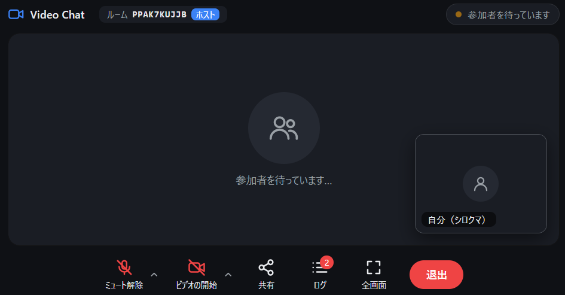

# Video Chat

Go WebAssembly と WebRTC P2P DataChannel を使ったビデオ通話アプリです．
"START VIDEO CHAT" ボタンを押すと，同じタイミングで待っている相手とマッチングしてビデオ通話ができます．

マッチメイキングサーバ・シグナリングサーバ・Web ページの配信は，このプロジェクトのサーバ 1 つが **localhost** で提供します．
外部への公開はこのプロジェクトには含まれず，Cloudflare Tunnel などのトンネリング（例: [gate-house](https://github.com/ka1222te/gate-house)）を通して行う前提です．

> カメラとマイクを許可すると，映像と音声が相手に送られます．



---

## 1. 仕組み

```
利用者 A のブラウザ                      利用者 B のブラウザ
   │  https://<公開 URL>/                   │
   ▼                                        ▼
トンネリング (例: gate-house + Cloudflare Quick Tunnel)   ← このプロジェクトの外
   ▼
Video Chat サーバ (bin/video-chat-server, 127.0.0.1:8080)
   ├ /             Web ページ (public/index.html, wasm_exec.js, video-chat.wasm)
   ├ /matchmaking  マッチメイキング (WebSocket) … 先着 2 人をペアにしてルーム ID を発行
   └ /signaling    シグナリング (WebSocket, Ayame 互換) … SDP / ICE candidate を中継

   接続が確立した後の映像・音声は，A と B のブラウザ間を WebRTC DataChannel で直接 (P2P) やり取りする
```

- 3 つの機能を **1 つのポート（単一オリジン）** で提供します．トンネルの公開 URL が 1 つでも全機能が使えます
- ブラウザ側（Go WASM）はページを開いた URL から接続先を決めます（`https://` なら `wss://<同じホスト>/...`，`http://` なら `ws://`）．
  公開 URL が変わっても再ビルドは不要です
- シグナリングは，マッチメイキングで発行したルーム ID だけを受け付けます（有効期限 5 分，1 ルーム 2 人まで）
- 待機中の WebSocket には定期的にメッセージを送ります．無通信の WebSocket を約 100 秒で切断する Cloudflare の仕様への対策です
- P2P 接続に使う STUN / TURN サーバは `.env` で設定します．シグナリング時にサーバからブラウザへ配布されます

### ファイル構成

| パス | 内容 |
|---|---|
| `client/` | ブラウザで動く Go WASM（ビデオ通話クライアント） |
| `server/` | ローカルサーバ（静的配信・マッチメイキング・シグナリング） |
| `go-ayame/` | Ayame クライアントライブラリ（Apache License 2.0，[NOTICE](NOTICE) 参照） |
| `public/` | 配信するファイル．`index.html` 以外はビルド時に生成 |
| `scripts/` | `setup.sh`（セットアップ・ビルド）・`start.sh`（起動）・`stop.sh`（停止）．どのディレクトリから実行しても可 |
| `.env.sample` | 設定ファイルのひな形（初回の `setup.sh` で `.env` にコピー） |
| `bin/` | ビルドしたサーバ（自動生成） |
| `.state/` | PID ファイル・ログ（自動生成） |
| `assets/` | README 用の画像 |

---

## 2. 要件

| 項目 | 内容 |
|---|---|
| OS | Linux（macOS / WSL でも動く想定．スクリプトは `bash`, `ps`, `stat -c` を使用） |
| Go | 1.26.10 以上，最新版を推奨（ビルド時のみ）．古い Go でビルドすると，`go.mod` に従って 1.26.10 が自動でダウンロードされる |
| ネットワーク | 初回ビルド時に Go モジュールを取得するためインターネット接続が必要 |
| 外部公開 | Cloudflare Tunnel などのトンネリング（このプロジェクトには含まれない．例: gate-house） |
| ブラウザ | WebAssembly・WebRTC・カメラ/マイク（`getUserMedia`）に対応した最近の Chrome / Edge / Firefox / Safari |

カメラとマイクはブラウザの仕様上 **HTTPS か `localhost`** のページでしか使えません．
トンネル経由（HTTPS）か，サーバと同じマシンの `http://localhost:8080/` で開いてください．

---

## 3. セットアップ

### 3.1 Go のインストール

<https://go.dev/dl/> から最新版の Go をインストールします（例: `/usr/local/go`）．
サポートが終了した古い Go（1.25 以前）は，標準ライブラリの脆弱性修正が提供されないため使わないでください．

```bash
go version   # go version go1.27.x などと表示されれば OK
```

`go` が PATH に無い場合は，3.2 で作られる `.env` に `GO='/path/to/go'` を設定してください．

### 3.2 ビルド

プロジェクトのディレクトリで実行します．

```bash
./scripts/setup.sh
```

次の処理をします．何度実行しても構いません（既存の `.env` は変更しません．ソースを変更したときもこれで再ビルドします）．

1. `.env` が無ければ `.env.sample` から作成
2. 使用中の Go に対応した `wasm_exec.js` を `public/` にコピー（Go と `wasm_exec.js` のバージョン不一致を防ぐため，毎回コピーします）
3. クライアントを `public/video-chat.wasm` にビルド
4. サーバを `bin/video-chat-server` にビルド

### 3.3 設定（.env）

既定値のままで動きます．必要に応じて `.env` を編集してください．値はシングルクォートで囲みます．
変更はサーバの再起動で反映されます．

| 変数 | 既定値 | 内容 |
|---|---|---|
| `LISTEN_ADDR` | `127.0.0.1:8080` | 待受アドレス．外部公開はトンネル経由で行うため `127.0.0.1` のままを推奨 |
| `STUN_URLS` | `stun:stun.l.google.com:19302` | STUN サーバ（カンマ区切りで複数可） |
| `TURN_URLS` | （空） | TURN サーバ（任意）．双方が厳しい NAT / ファイアウォールの内側にいて STUN だけでは繋がらないときに設定 |
| `TURN_USERNAME` / `TURN_CREDENTIAL` | （空） | TURN の認証情報 |
| `GO` | （空） | `go` が PATH に無い場合のパス（ビルド時のみ使用） |

`.env` は Git の追跡対象外です．TURN の認証情報を書いた場合は他人に共有しないでください．

---

## 4. 起動・停止・再起動

| 操作 | コマンド |
|---|---|
| 起動 | `./scripts/start.sh` |
| 停止 | `./scripts/stop.sh` |
| 再起動 | `./scripts/stop.sh && ./scripts/start.sh` |
| 再ビルドして再起動 | `./scripts/setup.sh && ./scripts/stop.sh && ./scripts/start.sh` |

### 起動

```bash
./scripts/start.sh
```

```
[+] Video Chat サーバ起動 (PID 12345): http://127.0.0.1:8080

ローカル確認 : http://localhost:8080/
外部公開     : gate-house の .env を ORIGIN_URL='http://127.0.0.1:8080' にして gate-house を起動
```

- バックグラウンドで起動し，ターミナルを閉じても動き続けます
- ビルド成果物が無ければ，先に `setup.sh` を自動で実行します
- 起動後に `/healthz` の応答を確認します．すぐ終了した場合はログの末尾を表示します

### 停止

```bash
./scripts/stop.sh
```

SIGTERM で停止します．10 秒以内に終わらなければ強制終了します．
通話中の 2 人の映像・音声は P2P で直接流れているため，停止しても確立済みの通話はそのまま続きます．新しいマッチングはできなくなります．

### 再起動

```bash
# .env の変更を反映
./scripts/stop.sh && ./scripts/start.sh

# ソースの変更を反映 (再ビルドしてから再起動)
./scripts/setup.sh && ./scripts/stop.sh && ./scripts/start.sh
```

---

## 5. アクセス方法

### 5.1 ローカルで確認する

サーバと同じマシンのブラウザで <http://localhost:8080/> を開きます．
ブラウザのタブを 2 つ開き，それぞれで "START VIDEO CHAT" を押すと自分同士で通話を確認できます．

### 5.2 トンネル経由で公開する（gate-house の例）

[gate-house](https://github.com/ka1222te/gate-house) を使うと，Google ログインで許可したユーザだけに `https://<WORKER_NAME>.<サブドメイン>.workers.dev` の固定 URL で公開できます．

1. このプロジェクトを起動する（`./scripts/start.sh`）
2. gate-house の `.env` の転送先を，このサーバに合わせる

   ```bash
   ORIGIN_URL='http://127.0.0.1:8080'   # LISTEN_ADDR に合わせる
   ```

3. gate-house を起動（起動済みなら再起動）する

   ```bash
   cd /path/to/gate-house   # gate-house を置いたディレクトリ
   ./scripts/stop.sh && ./scripts/start.sh
   ```

4. 利用者は gate-house の公開 URL を開き，Google でログインしてから "START VIDEO CHAT" を押す

補足:

- gate-house は WebSocket の `Origin` / `Host` を `ORIGIN_URL` に合わせて書き換えて中継します．このサーバは同一オリジンの WebSocket だけを受け付けるため，そのまま動きます
- gate-house 経由の接続では，サーバのログ（`.state/server.log`）にログインユーザのメールアドレスが記録されます
- gate-house を使わずに `cloudflared tunnel --url http://127.0.0.1:8080` で Quick Tunnel を直接張っても動きます．ただしその URL を知っている人は誰でもアクセスできます

### 5.3 ログ・状態の確認

| やりたいこと | 方法 |
|---|---|
| ログを見る | `tail -f .state/server.log`（マッチング・入退室の記録） |
| 稼働確認 | `curl http://127.0.0.1:8080/healthz`，または `ps -p $(cat .state/server.pid)` |

`server.log` は 10 MB を超えると，起動時に `server.log.1` へローテーションされます．

---

## 6. トラブルシューティング

| 症状 | 原因と対処 |
|---|---|
| `go が見つかりません` | Go をインストールするか，`.env` に `GO='/path/to/go'` を設定 |
| `既に起動中です` | 再起動する場合は `./scripts/stop.sh && ./scripts/start.sh` |
| `サーバがすぐに終了しました` | 表示されたログを確認．`address already in use` なら `.env` の `LISTEN_ADDR` のポートを変更（gate-house の `ORIGIN_URL` も合わせる） |
| `WASM is not initialized yet.` | ページの読み込み直後．数秒待ってから押す．続く場合は `./scripts/setup.sh` で再ビルドし，ブラウザを再読み込み |
| `Waiting match...` のまま進まない | 相手がまだいません．もう 1 人（または別タブ）で "START VIDEO CHAT" を押す |
| マッチング後に映像が出ない | P2P 接続に失敗しています．双方が厳しい NAT の内側にいる可能性があるため，`.env` に TURN サーバを設定 |
| カメラが起動しない | HTTPS か `localhost` で開いているか，ブラウザでカメラ・マイクを許可しているか確認 |
| gate-house 経由で WebSocket が繋がらない | gate-house の `ORIGIN_URL` が `LISTEN_ADDR` と一致しているか確認．gate-house のログに `origin websocket error` があればこのサーバが停止しています |

---

## 7. セキュリティ上の注意

- **相手に IP アドレスが伝わります**．映像・音声は相手のブラウザと直接（P2P）やり取りするため，接続の過程で互いの IP アドレスが相手に知られます．
  公開 URL は信頼できる相手にだけ案内してください（gate-house を使えば，Google ログインで許可したユーザに限定できます）
- **アクセス制限はこのサーバにはありません**．誰が使えるかはトンネル側（gate-house の許可リストなど）で制御します．
  `LISTEN_ADDR` は `127.0.0.1` のままにし，トンネル以外から直接アクセスできないようにしてください
- **TURN の認証情報は利用者のブラウザに配布されます**．`.env` の `TURN_USERNAME` / `TURN_CREDENTIAL` はシグナリング時に全利用者へ送られるため，
  使い回しのパスワードではなく，このアプリ専用で権限を絞った認証情報を設定してください
- Go のセキュリティ修正を取り込むため，Go は定期的に最新版へ更新し，`./scripts/setup.sh && ./scripts/stop.sh && ./scripts/start.sh` で再ビルドしてください

サーバ側では次の対策をしています．

| 対策 | 内容 |
|---|---|
| WebSocket のオリジン検査 | 同じオリジンのページからの接続だけを受け付ける（他サイトからの接続は 403） |
| ルーム ID の検証 | シグナリングはマッチメイキングが発行したルーム ID（推測困難な乱数，5 分間有効）だけを受け付け，1 ルーム 2 人まで |
| 接続数の上限 | WebSocket の同時接続は 256 まで（超えると 503） |
| セキュリティヘッダ | CSP（他サイトへの埋め込み禁止，画像は `data:` のみ，接続先は同じオリジンのみ），`X-Frame-Options`，`X-Content-Type-Options`，`Referrer-Policy`，`Permissions-Policy` |
| 静的ファイル | ディレクトリ一覧は表示しない |

ブラウザ側では，相手から届くデータを次のように扱います．

- 映像・音声はバイナリで受け取り，画像の形式（WebP / JPEG）はこちらで決めて表示する（相手が外部 URL などを読み込ませることはできない）
- 送信が回線に追いつかないときは映像フレームを間引き，遅延が伸び続けないようにする
- 文字列メッセージは 500 文字までに切り詰め，HTML としては解釈せずテキストとして表示する
- 相手のタイムスタンプによる待ち時間は最大 1 秒，音声の再生待ちは最大 50 チャンクに制限する

## 8. ライセンス

このプロジェクトは **Apache License 2.0** の下で公開しています．詳細は [LICENSE](LICENSE) を参照してください．

### go-ayame

`go-ayame/` ディレクトリのソースコードは，このプロジェクトのライセンスとは別に，元の go-ayame のライセンス（Apache License 2.0）に従います．
Kazuyuki Honda (hakobera) 作の go-ayame を ponyo877 が改変したものを，さらに改変して同梱しています．
Apache License 2.0 の条文は [LICENSE](LICENSE)，著作権表示と改変の記録は [NOTICE](NOTICE) を参照してください．

### ビルド時に組み込まれる Go モジュール

| モジュール | ライセンス |
|---|---|
| [github.com/pion/webrtc/v3](https://github.com/pion/webrtc) と関連する `github.com/pion/*` | MIT License |
| [nhooyr.io/websocket](https://github.com/nhooyr/websocket) | ISC License |
| [github.com/oklog/ulid/v2](https://github.com/oklog/ulid) | Apache License 2.0 |
| [github.com/google/uuid](https://github.com/google/uuid) | BSD 3-Clause License |
| [golang.org/x/crypto](https://pkg.go.dev/golang.org/x/crypto), [golang.org/x/net](https://pkg.go.dev/golang.org/x/net) | BSD 3-Clause License |
| [github.com/wlynxg/anet](https://github.com/wlynxg/anet) | BSD 3-Clause License |

### 実行時に使用する外部リソース

| リソース | ライセンス・利用条件 | 備考 |
|---|---|---|
| `wasm_exec.js`（The Go Authors） | BSD 3-Clause License | リポジトリには含めず，`setup.sh` が Go のインストール先からコピー |
| [mini.css](https://github.com/Chalarangelo/mini.css) v3.0.1 | MIT License | jsDelivr の CDN から読み込み |
| Google の公開 STUN サーバ（`stun.l.google.com`） | Google が提供する無償サービス（SLA なし） | `.env` の `STUN_URLS` で変更可 |

### 互換プロトコル

シグナリングは [OpenAyame/ayame](https://github.com/OpenAyame/ayame)（Apache License 2.0），
マッチメイキングは [ponyo877/easy-matchmaking](https://github.com/ponyo877/easy-matchmaking) のメッセージ形式に合わせて，このプロジェクト内で独自に実装しています．これらのソースコードは含みません．

外部公開に使うトンネリング（gate-house，Cloudflare など）はこのプロジェクトに含まれません．利用する場合はそれぞれのライセンス・利用規約に従ってください．
